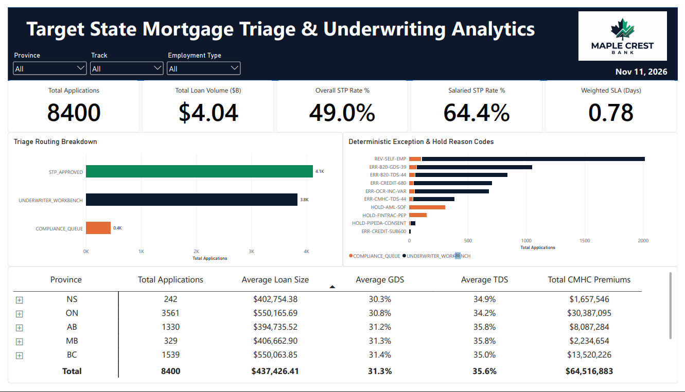
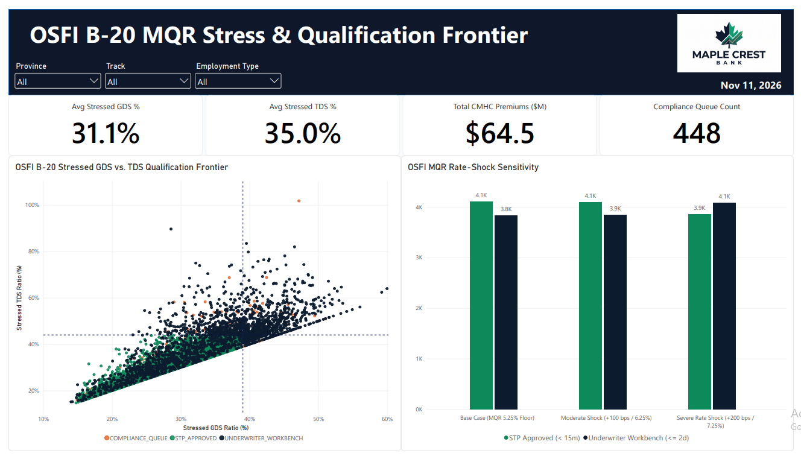

# Maple Crest Bank: Target State Mortgage Origination & Underwriting Triage

I built this end-to-end **Business Analysis (BA)**, **Enterprise Architecture (EA)**, and **Decision Analytics** case study to demonstrate how a mid-sized Canadian retail bank can modernize residential mortgage origination—reducing conditional pre-commitment turnaround from **6.0 business days to under 15 minutes** for Straight-Through Processing (STP) applications while maintaining strict compliance with **OSFI Guideline B-20**, **CMHC insurance rules**, **FINTRAC AML/ATF**, and **PIPEDA**.

> **Methodology & AI Co-Pilot Disclosure:**
>
> My primary focus in this project was the **Business Analysis, Regulatory Requirements Engineering, BPMN 2.0 Process Re-Engineering, and ArchiMate 3.x Target Architecture**. To translate my externalized business rules (`NFR-03`) and Gherkin acceptance criteria into a working validation sandbox, I leveraged generative AI as a **virtual software engineer** to scaffold the Python simulation modules (`config.py`, `generate_data.py`, `rules_engine.py`, `test_rules.py`, and `simulate_roi.py`) under my specifications and verification.

## 1. Executive Summary & Business Case

Maple Crest Bank processes approximately **8,400 retail residential mortgage applications annually (~$4.04B CAD)**. Under the legacy "As-Is" operating model, siloed manual document reviews, offline spreadsheet debt-service calculations, and sequential third-party checks resulted in a **6.0-day average turnaround SLA** and a **14.0% applicant abandonment rate**.

To solve this without risking a core banking replacement, I designed a **Strangler Fig API-first architecture** that decouples intake, external verification, and policy decisioning from the Legacy Core Loan Origination System (LOS). Based on my simulation model, this target operating model achieves:

| Strategic KPI | Legacy Baseline (As-Is) | Target State (To-Be) | Business Impact |
| :--- | :--- | :--- | :--- |
| **Overall Straight-Through Processing (STP)** | `0.0%` (100% Manual) | **`49.0%`** (`64.4%` Salaried) | **4,115** files/yr auto-qualified in `< 15 min` |
| **Weighted Average Turnaround SLA** | `6.0 Business Days` | **`0.78 Business Days`** | **87% reduction** in cycle time (`<= 2d` exceptions) |
| **Applicant Abandonment Rate** | `14.0%` (`1,176` lost) | **`5.1%`** (`426` lost) | **`+620` net recovered funded loans/yr** |
| **Automated Decline Rate (`BR-05`)** | N/A | **`0.0%` (Zero Auto-Declines)** | 100% of non-STP files route to human queues |
| **Net Annual Financial Benefit** | Baseline | **`$2,642,000 CAD / yr`** | **`5.5-month` payback** on `$1.20M` implementation |

## 2. Phase 1: Target Process & Enterprise Architecture

### To-Be Triage Process Map (BPMN 2.0)


In my re-engineered workflow, I replaced sequential handoffs with a **Parallel Scatter-Gather** verification pattern (`ADR-03`) across Equifax credit pulls (`FR-02`), OCR tax extraction (`FR-03`), and FINTRAC/Sanctions screening (`FR-05`). Applications then pass through deterministic routing (`OK-STP-PRIME`, `ERR-CMHC-TDS-44`, `HOLD-AML-SOF`) into a synchronous LOS write-back boundary with built-in error fallback.

### Target Layered Architecture (ArchiMate 3.x)


Aligned to **TOGAF ADM** and **ArchiMate 3.x**, I mapped executive drivers and goals down through business processes, decoupled microservices (`Origination Orchestration Engine`, `Externalized B-20 / CMHC Rules Engine`), and a single narrow `LOS Synchronous Write-Back API`. All cloud-native services are hosted on **Canadian sovereign cloud infrastructure (`ca-central-1`, `NFR-02`)** with AES-256 encryption and 7-year immutable audit logging.

## 3. Phase 2: Regulatory Rules Engine & Decision Analytics

### Executive Triage & OSFI B-20 Stress Dashboard (Power BI)




Using a calibrated synthetic portfolio of **8,400 Canadian residential mortgage applications**, I structured the externalized rules engine to enforce **Canadian semi-annual interest compounding**, CMHC tiered insurance premium capitalization (`LTV > 80%`), and OSFI's Minimum Qualifying Rate ($\text{MQR} = \max(\text{Contract Rate} + 2.00\%, 5.25\%)$). I then built an interactive two-page Power BI dashboard to visualize the triage funnel, exception Pareto drivers, and the GDS/TDS qualification frontier.

### OSFI MQR Rate-Shock Sensitivity Analysis

To prove out policy agility (`NFR-03`), I configured `simulate_roi.py` to stress-test the 8,400-application intake across three interest-rate floor scenarios without modifying core application logic:

| MQR Stress Scenario | MQR Floor | STP Approved (`<15m`) | Overall STP % | Underwriter Workbench | Compliance Queue | Avg GDS / TDS |
| :--- | :--- | :--- | :--- | :--- | :--- | :--- |
| **Base Case** | `5.25%` | `4,115` | **`49.0%`** | `3,837` | `448` | `31.1%` / `35.0%` |
| **Moderate Rate Shock (`+100 bps`)** | `6.25%` | `4,101` | **`48.8%`** | `3,851` | `448` | `31.2%` / `35.1%` |
| **Severe Rate Shock (`+200 bps`)** | `7.25%` | `3,863` | **`46.0%`** | `4,089` | `448` | `32.5%` / `36.4%` |

## 4. Repository Structure

```text
mortgage-underwriting-ba-case-study/
├── analytics/
│   ├── config.py                            # Externalized OSFI B-20, CMHC & FINTRAC thresholds (NFR-03)
│   ├── generate_data.py                     # Synthetic intake generator (8,400 Canadian applications)
│   ├── rules_engine.py                      # Canadian semi-annual compounding & deterministic triage engine
│   ├── test_rules.py                        # Automated Gherkin acceptance & compliance test suite (pytest)
│   ├── simulate_roi.py                      # As-Is vs. To-Be SLA/ROI & MQR rate-shock sensitivity model
│   └── maple_crest_triage_dashboard.pbix    # Interactive 2-page Power BI executive dashboard
├── architecture/
│   ├── source/                              # Native .bpmn and .archimate source models
│   └── exports/                             # High-resolution PNG deliverables & brand assets
├── data/
│   ├── synthetic_applications.csv           # Generated raw borrower intake dataset
│   ├── triaged_applications.csv             # Evaluated portfolio with MQR ratios & reason codes
│   └── dashboard_exports/                   # Aggregated CSVs powering Power BI visuals
├── docs/                                    # BRD, Functional/Non-Functional Specs, ADRs & Risk Register
└── README.md
```

## 5. How to Reproduce My Simulation & Tests

1. **Activate the virtual environment & install dependencies:**
   ```powershell
   python -m venv .venv
   .\.venv\Scripts\Activate.ps1
   pip install -r requirements.txt
   ```

2. **Generate synthetic applications & run the B-20 / CMHC triage engine:**
   ```powershell
   python analytics/generate_data.py
   python analytics/rules_engine.py
   ```

3. **Execute the automated Gherkin verification suite (`6/6` tests):**
   ```powershell
   pytest -v analytics/test_rules.py
   ```

4. **Run the ROI & OSFI MQR rate-shock sensitivity simulation:**
   ```powershell
   python analytics/simulate_roi.py
   ```